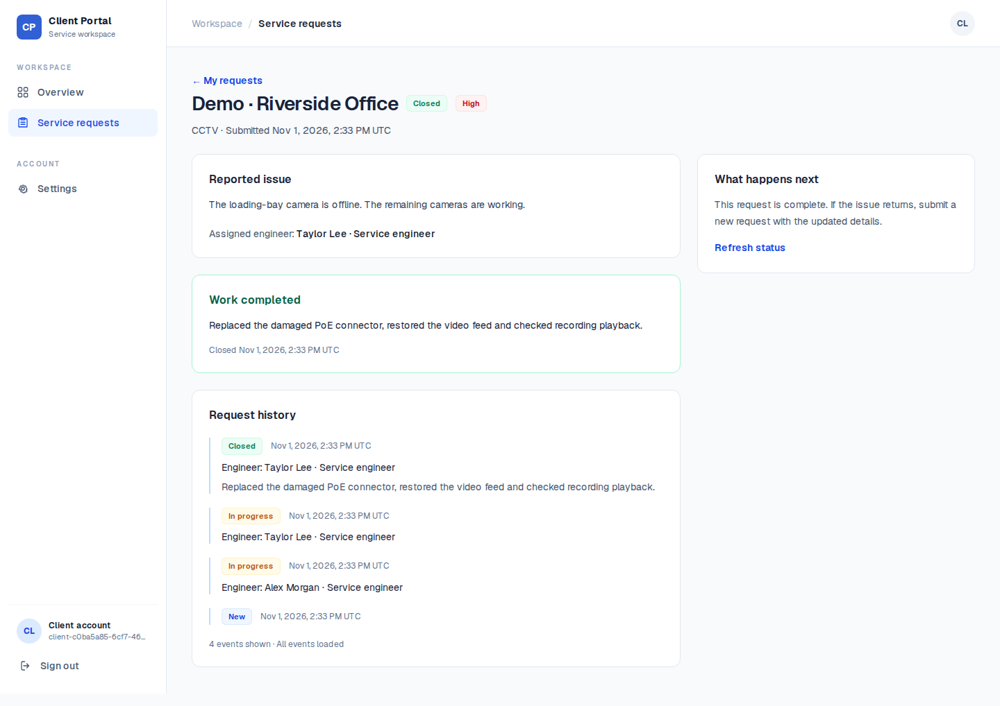
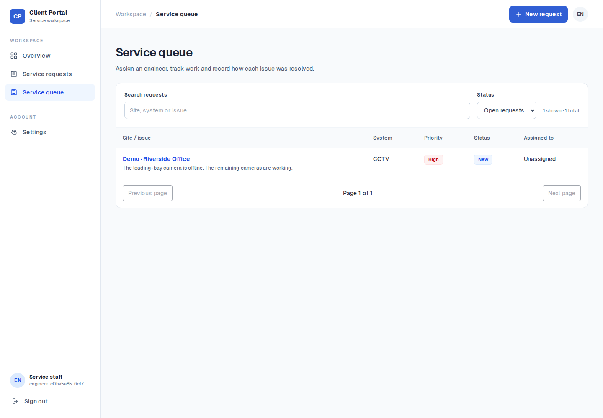
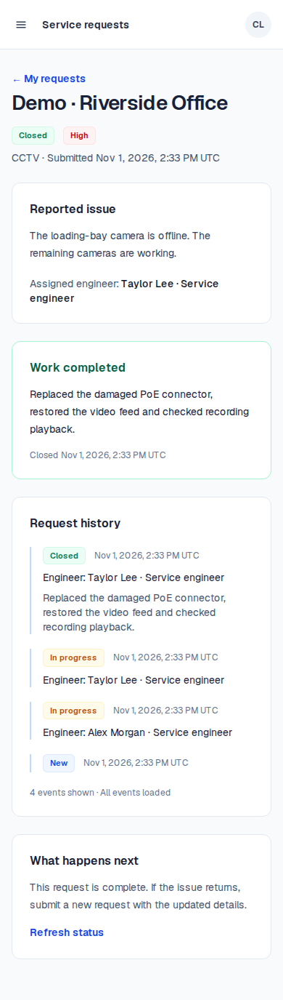

# Client Portal Dashboard

A service portal for building systems: report a fault, assign an engineer and record the repair.

[Live application](https://client-portal-dashboard-one.vercel.app) · [CI](https://github.com/bondarenkodenis0907-web/client-portal-dashboard/actions)

[Follow a completed repair](docs/COMPLETED_SCENARIO.md): client reports an offline CCTV camera → engineer takes the job → repair is recorded → client reads the result and history.

Built with Next.js, React, TypeScript, Tailwind CSS and Supabase. Screenshots use fictional accounts and requests.

## Project status

The [live application](https://client-portal-dashboard-one.vercel.app) runs application source `b001fd9`, released on 2 November 2026. Production has fourteen migrations. Sites/buildings, explicit admission, manager site editing, contract versions and private PDF publication/download are deployed. Authenticated production acceptance is pending; equipment, building documents, planned work and building-scoped requests remain planned.

Candidate verification: 46 unit/policy, 346 SQL and 41 browser checks plus server integration, guard, maintenance, compatible rollback and synthetic restore. Separate main CI, the bounded production-backup evidence and hosted-smoke limitations are in the [release record](docs/PRODUCTION_RELEASE_20261102.md). Do not replay historical migrations. Hosted password-recovery acceptance is deferred by owner decision.

PDFs up to 2 MiB are private PostgreSQL records, published by an explicitly admitted manager. Ordinary staff cannot manage contracts; clients only see the published version of admitted sites. [Directory](docs/FACILITY_DIRECTORY.md) · [Management](docs/SITE_CONTRACT_MANAGEMENT.md) · [Roadmap](docs/PROJECT_MASTER_PLAN.md).

## Features

- Clients see their own requests; active staff share the service queue.
- Requests move from new to in progress to closed, with a required repair note and database-recorded history.
- Submission keys prevent duplicate requests; version checks reject concurrent edits.
- Server-side request search and pages keep older records reachable.
- Password recovery uses an email link, explicit confirmation and server-confirmed logout.
- Preview access is blocked until an isolated backend is approved.

## Development

Use Node 24.19.0, npm 11.17.0 and Docker. Run `npm ci`, then follow [local setup and tests](docs/DEVELOPMENT.md).

Local changes are not released to the live application. See the [dated local verification](docs/evidence/verification.json), [environments](docs/ENVIRONMENT_REGISTER.md) and the [release checklist](docs/RELEASE_ROLLBACK_RUNBOOK.md). Future releases require their own reviewed scope and authorization.

The next milestone is a pilot at one real site: [development plan](docs/PROJECT_MASTER_PLAN.md) · [decisions](docs/DECISIONS.md) · [acceptance criteria](docs/QA_ACCEPTANCE_MATRIX.md).

General request attachments, notifications, SLA escalation, reopening and separate contractor teams are not implemented; contract PDFs are supported.
