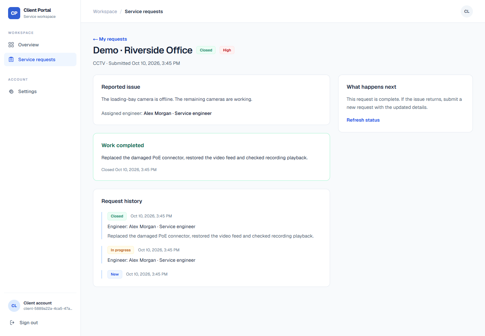
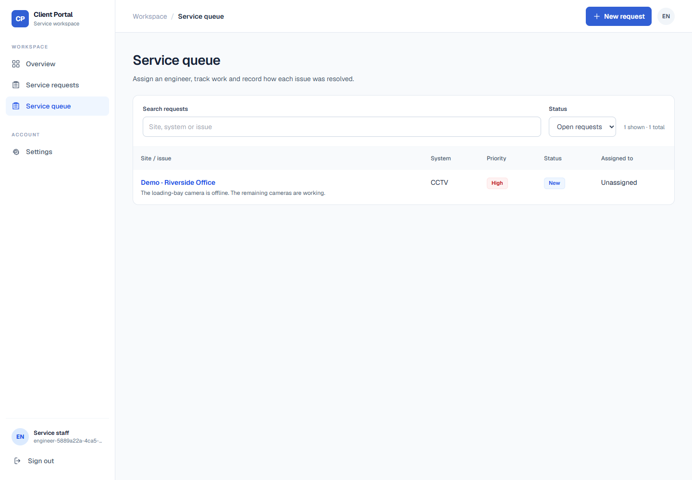
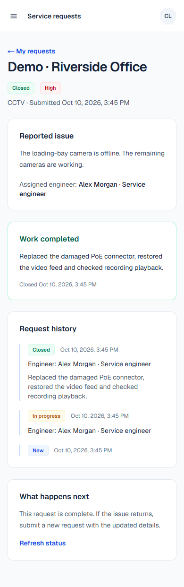

# Client Portal Dashboard

A service portal for building systems: report a fault, assign an engineer and record the repair.

[Live application](https://client-portal-dashboard-one.vercel.app) · [CI](https://github.com/bondarenkodenis0907-web/client-portal-dashboard/actions)

Built with Next.js, React, TypeScript, Tailwind CSS and Supabase. Screenshots use fictional accounts and requests.

## Features

- Clients see their own requests; active staff share the service queue.
- Requests move from new to in progress to closed, with a required repair note and database-recorded history.
- Submission keys prevent duplicate requests; version checks reject concurrent edits.
- Server-side request search and pages keep older records reachable.
- Password recovery uses an email link, explicit confirmation and server-confirmed logout.
- Preview access is blocked until an isolated backend is approved.

## Development

Use Node 24.19.0, npm 11.17.0 and Docker. Run `npm ci`, then follow [local setup and tests](docs/DEVELOPMENT.md).

Local changes are not released to the live application. See [verification](docs/evidence/verification.json), [environments](docs/ENVIRONMENT_REGISTER.md) and the [release checklist](docs/RELEASE_ROLLBACK_RUNBOOK.md). Publication still requires approval.

The next milestone is a pilot at one real site: [development plan](docs/PROJECT_MASTER_PLAN.md) · [decisions](docs/DECISIONS.md) · [acceptance criteria](docs/QA_ACCEPTANCE_MATRIX.md).

Attachments, notifications, SLA escalation, reopening and separate contractor teams are not implemented.
