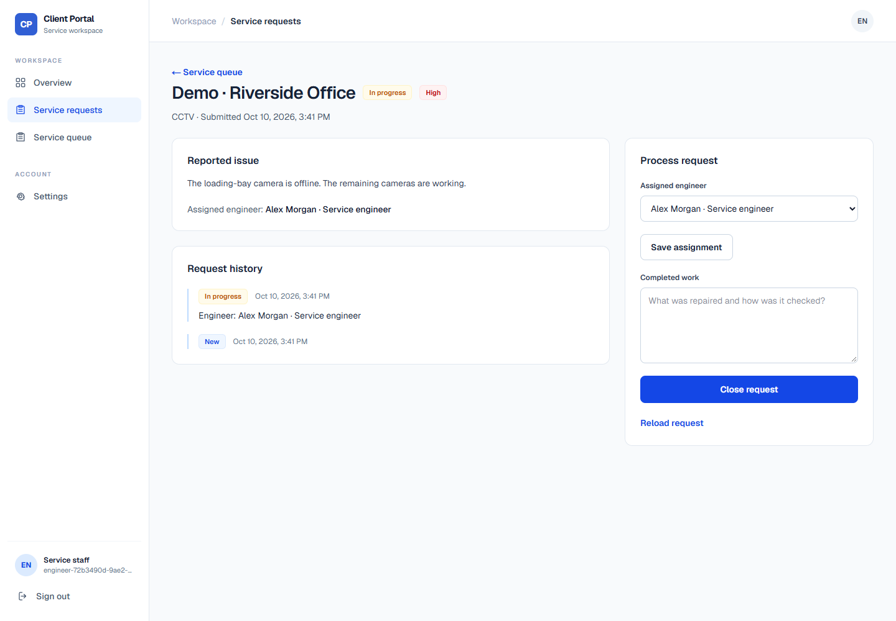

# Client Portal Dashboard

A building-systems service portal: report an issue, assign an engineer and return a recorded resolution to the client.

[Live application](https://client-portal-dashboard-one.vercel.app) · [Checks](https://github.com/bondarenkodenis0907-web/client-portal-dashboard/actions) · [Discuss a similar project](https://t.me/BDenisD)

## Completed work the client can verify

An offline loading-bay camera is reported, assigned and closed with a repair note. The client sees who handled it, what changed and when the request closed.

This is a portfolio project based on my experience supporting building systems. Screenshots show fictional accounts and requests against a local test backend.

## The workflow

| Step | What the application records |
| --- | --- |
| Report | Site, system, issue and priority; each client sees their own requests. |
| Assign | Staff choose an active engineer and start work in the shared queue. |
| Close | Completed-work text is required. PostgreSQL records the resolution, closure time and history together. |
| Verify | The client reads the resolution and status history. Closed requests remain read-only. |

## Engineering checks

- PostgreSQL RLS separates clients' requests and history. Administrator-managed staff membership grants access to one shared service queue.
- Updates check the last observed modification time. Failed and conflicting saves preserve the draft; closed requests and revoked staff access block further processing.
- SQL tests cover permissions, validation and lifecycle transitions. Browser regressions cover submission, assignment, closure, stale saves, draft preservation, staff deactivation and mobile layout.
- CI runs formatting, lint, types, a production build and isolated database/browser checks without production credentials.

Next.js, React, TypeScript and Tailwind CSS provide the interface; Supabase provides authentication and PostgreSQL. The application does not use a browser service-role key.

[Development, staff access and verification](docs/DEVELOPMENT.md) · [Dependency notes](docs/DEPENDENCY_SECURITY.md)

Current scope: intake, assignment, processing, closure and client-visible history. Attachments, notifications, SLA escalation, reopening, pagination and separate contractor teams are not implemented.
