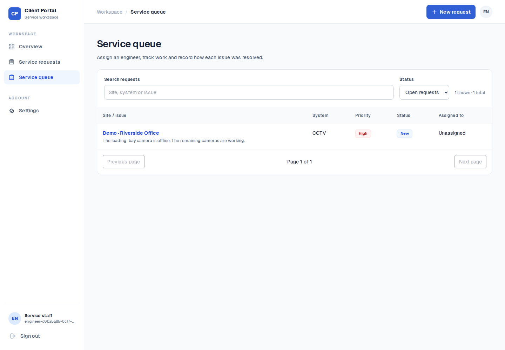
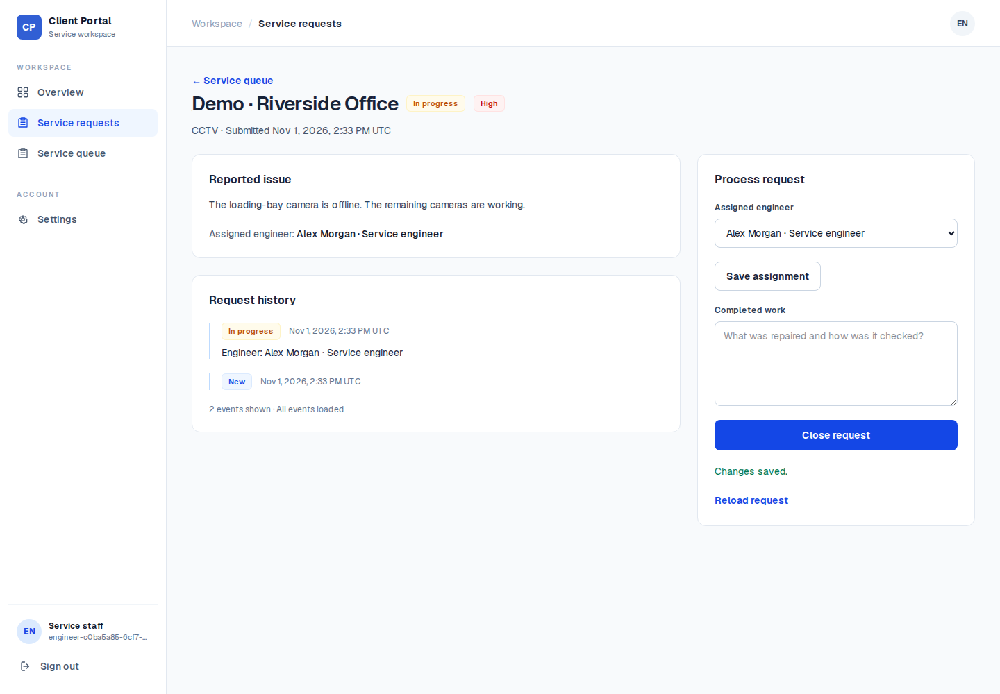
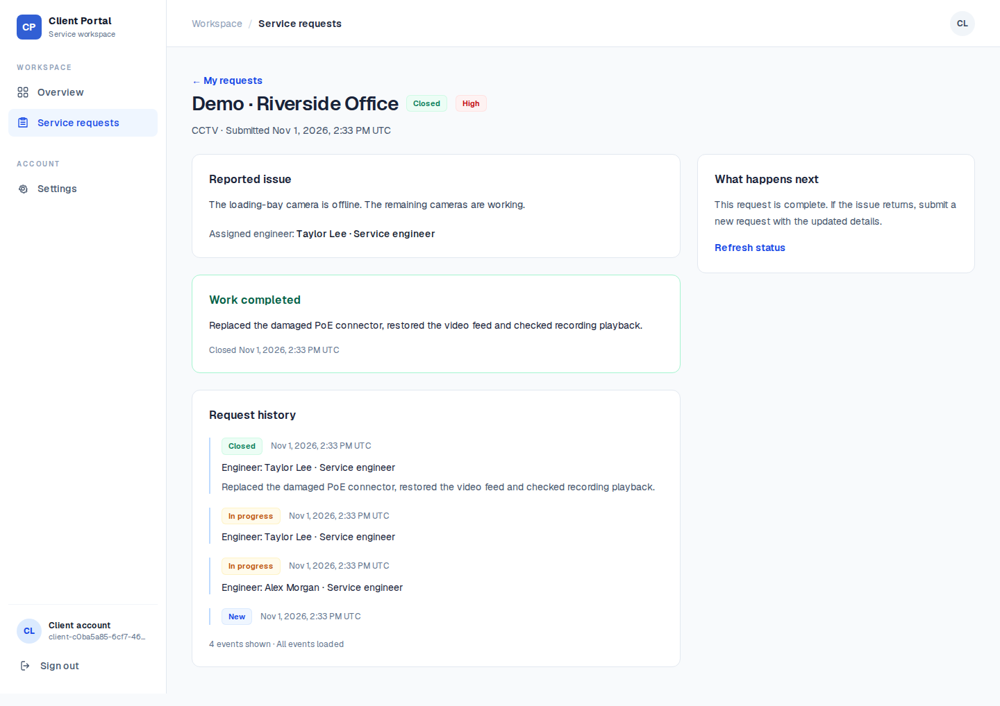
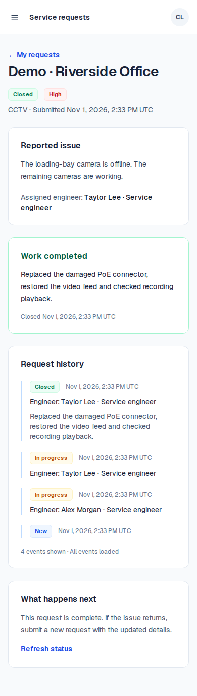

# From camera fault to completed repair

A site coordinator reports an offline loading-bay CCTV camera. An engineer takes the request, records the repair and closes it. The coordinator can then read the result and its history.

This walkthrough uses existing application screenshots with fictional accounts and site data. It is a recorded example, not a claim that the live deployment contains every change in the release candidate.

## 1. Report the fault

As a client, open Service requests and submit:

- Site: Demo · Riverside Office
- Technical system: CCTV
- Issue: The loading-bay camera is offline. The remaining cameras are working.
- Priority: High

The request starts as New. The client sees their own requests; active staff can see it in the service queue.



## 2. Assign an engineer and start work

Open the request from the staff queue, choose an active engineer and select Assign and start work. The request becomes In progress and the assignment appears in history.



## 3. Record the repair and close the request

Enter the completed work: “Replaced the damaged PoE connector, restored the video feed and checked recording playback.” Select Close request.

The completed request shows the repair note, responsible engineer, closed status and history. A client can reopen the request page to read the result.



## 4. Check the client view on mobile



## Reproduce and verify

Follow [local setup](DEVELOPMENT.md), including the pinned Node/npm versions and Docker, then run:

```sh
npm ci
npm run test:local
npm run test:local:stop
```

The first test in [request-processing.spec.ts](../tests/browser/request-processing.spec.ts) creates temporary client/staff accounts against the guarded loopback backend, submits the issue, assigns work, closes it and checks the client view. It also checks the persisted status, engineer, repair note and closing timestamp, rejects a stale edit and checks browser errors and mobile overflow. Temporary accounts and requests are removed afterwards.

To refresh the walkthrough screenshots, run the same isolated suite with `CAPTURE_PORTFOLIO=1`. Review the images before committing them: this option writes to `public/screenshots`. No public demo credentials are provided.

The current test also exercises reassignment and failure recovery, so regenerated history can contain more events than these older screenshots. A new local browser run was not performed during the 1 November documentation review because Docker was unavailable; see the candidate CI results for execution evidence.
